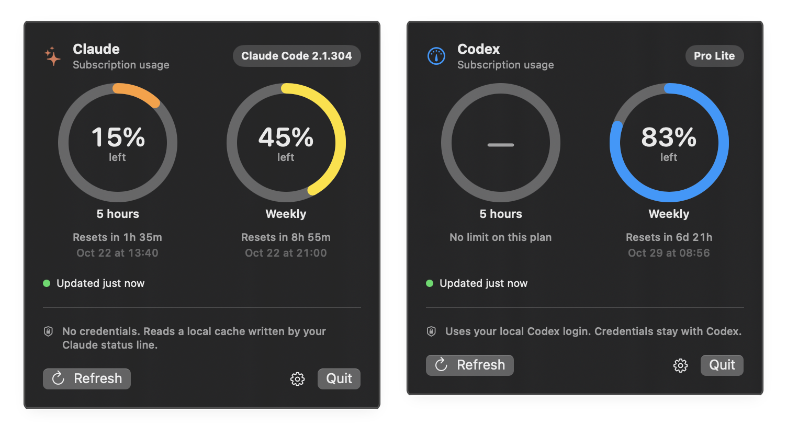

# Agent Gauge

How much of your Claude Code and Codex limits is left, right in your Mac's menu bar.

<p align="center">
  
</p>

Each agent gets a small menu bar icon with two rings: the outer ring is the weekly limit, the inner ring the 5-hour window. Rings turn orange under 25% and red under 10%. Click one for exact numbers and reset times.

## Install

[**Download the latest release**](https://github.com/joargp/agent-gauge/releases/latest), unzip it, move **Agent Gauge** to Applications, and open it. The welcome window lets you pick your agents and connect Claude Code.

Signed and notarized by Apple. Needs macOS 14 or later, on Apple silicon or Intel.

Or build from source (needs the Xcode command-line tools):

```bash
git clone https://github.com/joargp/agent-gauge.git
cd agent-gauge
./script/install.sh
```

## Privacy

- **Claude Code:** reads the usage numbers Claude Code passes to its status line. No Keychain access, no tokens, no network requests.
- **Codex:** asks your installed Codex CLI. Your login and tokens stay with Codex.

Prompts, transcripts and code are never read.

## More

Custom status lines, uninstalling, building releases, and how it all works: [docs/details.md](docs/details.md).

MIT licensed. An independent project, not affiliated with Anthropic or OpenAI.
